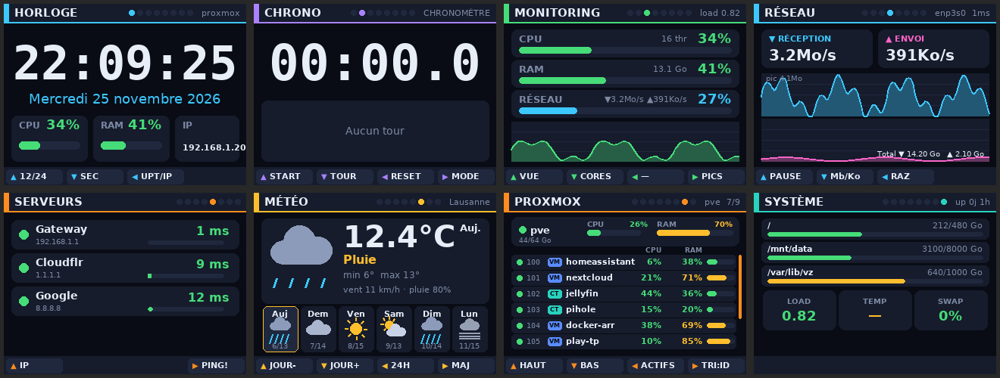

# Logitech G19 HUD

Un tableau de bord pour l'**écran LCD couleur 320×240** et les touches du **Logitech G19**, sans pilote Logitech
(ni LGS, ni G HUB) : le G19 est piloté directement en USB avec Python.

Monitoring, réseau, pings, **VM et conteneurs Proxmox**, stockage (et horloge, chrono, météo en option) — avec les touches LCD, G1–G12 et M1–M3
du clavier pour naviguer. Pensé pour un G19 branché sur un **serveur Linux / Proxmox** (service systemd), et utilisable sous **Windows**.



*(les 8 écrans, y compris ceux en option ; captures générées avec des données fictives par `tools/render_screens.py`, sans G19 branché)*

## Les écrans

Affichés par défaut (dans cet ordre) :

| Écran | Contenu | Boutons ▲ ▼ ◀ ▶ |
|---|---|---|
| **Monitoring** | jauges CPU / RAM / **réseau** (débit ▼▲ et % du lien), température, load, courbe, vue par cœur | vue · cœurs · batterie · pics |
| **Réseau** | débits ▼▲ en direct, deux courbes, totaux | pause · unité · RAZ |
| **Serveurs** | pings des hôtes configurés, IP locale/publique, VPN | IP · … · ping |
| **Proxmox** | nœud (CPU/RAM) + liste des **VM et conteneurs** (état, CPU, RAM), via l'API Proxmox en lecture seule | haut · bas · tous/actifs · tri |
| **Système** | volumes, load, température, swap | — |

Disponibles sur demande : **Horloge**, **Chrono** (chronomètre / minuteur) et **Météo** (Open-Meteo, 6 jours + courbe 24 h).
Choix et ordre avec `G19_SCREENS` (ex. `G19_SCREENS=horloge,monitoring,proxmox`, ou `all`).

Navigation : **Menu / OK** = écran suivant · **Retour** = précédent · **Home** (carré) = écran on/off ·
**G1…G12** = saut direct à l'écran n · **M1 / M2** = précédent / suivant · **MR** = écran on/off.

### Écran Proxmox

Lecture seule, via un jeton d'API qui n'a que le rôle `PVEAuditor` (il ne peut ni démarrer ni arrêter une VM).
Sur l'hôte Proxmox :

```bash
sudo ./linux/proxmox-token.sh --write      # crée g19hud@pve + jeton, écrit /etc/default/g19-hud (0600), redémarre le service
```

> ⚠️ Ce script n'a pas encore tourné sur un vrai Proxmox (le client API est testé contre un faux serveur HTTPS,
> `python -m unittest tests.test_proxmox`). Configuration manuelle : section `[proxmox]` de `config.toml` ou variables `PVE_*`
> (voir [`g19_proxmox.py`](g19_proxmox.py)). `PVE_DEMO=1` affiche l'écran avec des VM fictives, sans serveur.

## Installation

### Linux / Proxmox (testé sur un G19 réel via WSL2 + systemd)

```bash
git clone https://github.com/pinkfloydFR/logitech-G19.git
cd logitech-G19
sudo ./linux/install.sh
journalctl -u g19-hud -f
```

Installe les paquets, un utilisateur système, la règle udev (accès sans root, démarrage au branchement) et le service
`g19-hud`. Détails et options : [`linux/`](linux/) et [`CLAUDE.md`](CLAUDE.md).

### Windows (testé sur un G19 réel, Windows 11)

1. Installer le pilote **WinUSB** sur l'interface 0 de l'écran avec [Zadig](https://zadig.akeo.ie/) (une seule fois).
2. `.\windows\run.ps1`

Pas-à-pas, limites (touches G/M) et retour en arrière : [`windows/README.md`](windows/README.md).

## Configuration

Variables d'environnement (service Linux : `/etc/default/g19-hud`) :

| Variable | Défaut | Rôle |
|---|---|---|
| `G19_BRIGHTNESS` | `100` | luminosité de l'écran, 0–100 |
| `G19_SCREENS` | `monitoring,reseau,serveurs,proxmox,systeme` | écrans affichés et leur ordre (`horloge`, `chrono`, `meteo` aussi ; `all` = tous) |
| `G19_UI` | `native` | `native` = interface couleur ; `retro` = rendu monochrome 160×43 agrandi |
| `G19_THEME` | `amber` | thème du mode `retro` : `amber`, `blue`, `green`, `white`, `amber-dark`, `matrix` |
| `G19_BACKEND` | `auto` | `g19`, ou `g15` pour le G15 d'origine |
| `G19_DEBUG` | — | `1` = affiche les rapports de touches bruts |
| `PVE_HOST`, `PVE_TOKEN_ID`, `PVE_TOKEN_SECRET`, `PVE_FINGERPRINT`, `PVE_DEMO` | — | écran Proxmox (voir plus haut) |

Hôtes pingés, ville météo de repli, FPS… : `config.toml`, créé au premier lancement dans le dossier du programme.

## Comment ça marche

Le G19 expose son écran comme un périphérique USB `046d:c229` : on lui envoie des trames **RGB565** de 320×240 en
*bulk* (précédées d'un en-tête de 512 octets), l'image est stockée **en portrait 240×320** (miroir + rotation à
l'envoi), et les touches arrivent sur deux endpoints interrupt. Le protocole complet, mesuré sur un vrai G19
(codes des touches LCD, G/M, touche « soleil », rétroéclairage, luminosité), et les pièges rencontrés
(⚠️ ne jamais interrompre une trame en cours d'envoi) sont dans [`CLAUDE.md`](CLAUDE.md).

| Fichier | Rôle |
|---|---|
| `g19_lcd.py` | pilote USB (pyusb/libusb) |
| `g19_hud.py` | interface couleur native 320×240 |
| `g19_proxmox.py` | client de l'API Proxmox (lecture seule) |
| `g19_dashboard.py` | application : télémétrie, boutons, boucle de rendu, backends |
| `tools/render_screens.py` | rend les écrans en PNG sans matériel |
| `linux/`, `windows/` | installation par système |

## Origine du projet

Ce projet est un **fork de [DPKoss/G15-Retro-HUD](https://github.com/DPKoss/G15-Retro-HUD)** (MIT), un tableau de bord
pour l'écran monochrome 160×43 des Logitech **G15**. On en a gardé la télémétrie, la logique des écrans et le backend
G15 (toujours utilisable avec `G19_BACKEND=g15`) ; le support du G19 (pilote, interface couleur, portage Linux et
Windows) est un ajout. Le README, les captures et les fichiers de packaging d'origine sont conservés dans
[`docs/upstream-g15/`](docs/upstream-g15/).

## Licence

MIT, comme le projet d'origine (voir [`LICENSE`](LICENSE)). Protocole USB du G19 d'après
[libg19](https://github.com/jgeboski/libg19) et d'autres implémentations, validé sur du matériel réel.
