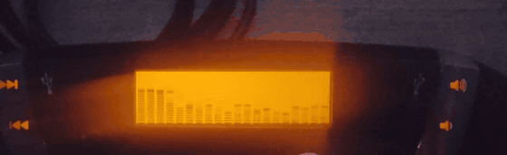

# G15-Retro-HUD


-FF8C00)


**Dashboard autonome en espace utilisateur pour l'écran LCD monochrome (`160×43`) et les 5 boutons des claviers Logitech G15 (v1 & v2) sous Windows 10/11, sans aucun pilote propriétaire.**

> 🇫🇷 **Français** · 🇬🇧 **[English documentation](README.md)**

[](https://youtu.be/d3aF21h4JUE)

> **▶ [Voir le tour complet des 8 écrans sur YouTube (2:33)](https://youtu.be/d3aF21h4JUE)** · *(cliquez sur l'aperçu ci-dessus ou sur le lien)*

---

## À propos

En ressortant mon vieux **G15** vieux de près de 20 ans, j'ai voulu rallumer son LCD sous Windows 11 sans installer d'anciens pilotes noyau qui imposent de désactiver l'Isolation du noyau (HVCI). Le projet a d'abord été *vibe-codé* et utilisé en local sur plusieurs itérations avant d'être nettoyé et publié tel quel en **v0.2.0** sous la forme d'un script unique (`g15_dashboard.py`).

En bref, comment ça tourne :
* **USB Raw HID direct :** compatible **G15 v2** (`046d:c227`, ambré) et **G15 v1** (`046d:c222`, bleu), avec reconnexion automatique toutes les 2 s (sortie de veille ou dock USB).
* **Sondes natives Windows :** `nvml.dll` (charge, VRAM, °C NVIDIA), `iphlpapi.dll` (routage et détection VPN) et `user32.dll` sont appelés via `ctypes` - pas besoin de `pynvml` ni `pywin32`, avec bascule WMI iGPU hors NVIDIA.
* **Rendu 1-bit net :** Pillow sans antialiasing (`fontmode = "1"`) en `Tahoma` 9 px pour garder les accents français lisibles pixel par pixel.
* **Dépendances à la carte :** seuls `hidapi`, `psutil` et `pillow` sont requis ; audio, média Windows et icône System Tray sont optionnels.

---

## Prérequis & Installation

### Option A - Exécutable Windows autonome (sans Python)

Téléchargez **`G15-Retro-HUD-v0.2.0-win64.exe`** depuis la page [**Releases**](https://github.com/DPKoss/G15-Retro-HUD/releases) et lancez-le directement (un seul fichier, aucune installation, tourne dans la zone de notification Windows).

> **Reproductibilité :** le binaire est compilé depuis le fichier [`G15-Retro-HUD.spec`](G15-Retro-HUD.spec) public (automatisé par [GitHub Actions](.github/workflows/release.yml) à chaque tag `v*`) et peut être recompilé localement avec `.\build.ps1`. Comme tout binaire PyInstaller `--onefile` non signé, il s'extrait dans `%TEMP%` au démarrage : en cas d'alerte SmartScreen/antivirus, utilisez plutôt l'Option B ci-dessous.

### Option B - Depuis les sources (Python 3.11+)

* **Windows 10 / 11 (x64)** et **Python 3.11+** (`tomllib` intégré et requis par les roues `winrt-*`).

> [!WARNING]
> **Attention sur PyPI (`hidapi` ≠ `hid`) :** installez bien **`hidapi`** et pas le paquet homonyme `hid`, dont l'API est incompatible avec `hid.device()`.

```bash
git clone https://github.com/DPKoss/G15-Retro-HUD.git
cd G15-Retro-HUD

# Installation complète recommandée
pip install -r requirements.txt

# Ou installation minimale (sans spectre audio, média Windows ni System Tray)
pip install hidapi psutil pillow
```

| Paquet `pip` | Rôle | Statut |
| :--- | :--- | :--- |
| `hidapi` | Communication USB Raw HID (`import hid`) | **Obligatoire** |
| `psutil` | Sondes CPU, RAM, batterie et réseau | **Obligatoire** |
| `pillow` | Rendu 1-bit `160×43` et polices Windows | **Obligatoire** |
| `pystray` | Icône et menu dans la zone de notification | Optionnel *(repli console)* |
| `pyaudiowpatch` | Capture audio WASAPI Loopback | Optionnel *(sans spectre)* |
| `numpy` | FFT 20 bandes, encodage HID rapide, Demoscene | Optionnel *(repli Python)* |
| `winrt-runtime`, `winrt-Windows.Foundation`, `winrt-Windows.Media.Control` | Session média Windows GSMTC (titre, artiste, seek) | Optionnel *(écran Média)* |

---

## Lancement & Configuration

```bash
python g15_dashboard.py
# Ou sans fenêtre console (tourne dans le System Tray) :
pythonw g15_dashboard.py
```

Au premier lancement, deux fichiers locaux (ignorés par Git) sont générés :
* **`config.toml`** : FPS, priorité Wi-Fi/Ethernet, 3 hôtes à pinger, ville météo de repli sous VPN et délais plein écran. Rechargeable à chaud via clic droit sur le System Tray → **Recharger config.toml**.
* **`g15_keymap.json`** : mappage des 5 boutons (préconfiguré pour le **G15 v2**). Sur un **G15 v1** (`046d:c222`), utilisez clic droit → **Recalibrer les boutons** et suivez le LCD.

---

## Les 8 écrans & Boutons

* **Bouton rond (Applet) :** appui court = écran suivant (`1/8` → `8/8`) · appui long (> 0,9 s) = veille / réveil du LCD.

| # | Écran | Contenu | Boutons `[1]` `[2]` `[3]` `[4]` |
| :-: | :--- | :--- | :--- |
| **1** | **Horloge** | Heure grand format, date, CPU ou batterie, uptime | `12/24` · `SEC` · `UPT/DATE` · `-` |
| **2** | **Chrono / Minuteur** | Chrono au 1/10e avec tours ou minuteur avec alerte flash | `START/PAUSE` · `TOUR/DURÉE` · `RESET` · `MODE` |
| **3** | **Monitoring** | CPU / RAM / GPU (ou Batterie), historique, jusqu'à 64 threads, °C NVIDIA | `VUE` · `CORES` · `BAT/GPU` · `PICS` |
| **4** | **Média & Visu** | Titre/Artiste/App (Spotify, navigateur, VLC…), seek, spectre & **4 visualiseurs plein écran** (Winamp, Oscillo, Tunnel Basses, VU-mètre L/R) | `-15s` · `+30s` · `SPECTR` · `VISU` |
| **5** | **Réseau** | Oscilloscope Down/Up sur la carte physique active (sans double comptage VPN/WSL) + Go cumulés | `PAUSE` · `UNITÉ` · `RAZ` · `Total Go` |
| **6** | **Serveurs & VPN** | Pings ICMP (3 hôtes), IP locale, IP publique et badge `[VPN]` auto | `IP LOC / SERV` · `-` · `-` · `PING!` |
| **7** | **Météo** | Géo-IP hors VPN (ville de repli sous VPN) via Open-Meteo, sprites 16×16, J+6 et courbe 24h | `< JOUR` · `JOUR >` · `24H / JOURS` · `MAJ` |
| **8** | **Demoscene & Pong** | **6 démos 1-bit `160×43`** (Hyperespace, Matrix, Plasma, Doom Fire, Torus 3D, Rotozoomer) + **Pong jouable** (20 FPS) | `< EFF` · `EFF >` · `AUTO` · `PONG` *(maintien `HAUT`/`BAS`)* |

*(En mode **Visu** et **Demoscene**, la barre des boutons se masque après 3 s pour libérer toute la dalle `160×43`.)*

---

## Réseau & Confidentialité

Le script n'intègre aucune télémétrie, aucun compte et n'envoie rien à son auteur. Il effectue toutefois trois types d'appels réseau automatiques en arrière-plan :

* **Pings ICMP** toutes les `10 s` (`ping_interval_sec`) vers les 3 hôtes de `config.toml` (`192.168.1.1`, `1.1.1.1`, `8.8.8.8` par défaut).
* **`https://ipwho.is/`** (repli `https://api.ipify.org`) toutes les `10 min` (`refresh_minutes`, ainsi qu'au changement d'état VPN ou via `PING!` / `MAJ`), avec l'en-tête `User-Agent: G15-HUD/0.2.0` : expose votre **IP publique** à ce service tiers pour afficher l'IP WAN (écran 6) et déterminer votre ville météo hors VPN (écran 7). *Note : cet appel reste effectué même sous VPN ou avec `auto_detect_ip = false` afin de rafraîchir l'IP publique de l'écran 6, tandis que la météo bascule alors sur la ville de repli définie dans `config.toml`.*
* **`https://api.open-meteo.com/v1/forecast`** toutes les `10 min` avec uniquement des coordonnées latitude/longitude (issues de la géo-IP hors VPN, ou de `fallback_lat`/`fallback_lon` sous VPN ou si `auto_detect_ip = false`).

---

## Roadmap & Contributions

Issues (notamment retours sur **G15 v1 bleu**), idées et Pull Requests sont les bienvenues :

- [ ] **Touches macros G1–G6, banques M1–M3/MR & LEDs** via Feature Reports HID.
- [ ] **Bascule audio WASAPI dynamique** lors d'un changement de sortie par défaut sous Windows.
- [ ] **Indicateur / coupe-micro universel** (`IAudioEndpointVolume`) et alertes flash inter-écrans.
- [ ] **Traduction anglaise (EN)** de l'interface, de `config.toml` et de la doc.
- [ ] **Découpage modulaire / portage Rust** (exécutable natif autonome).

Contact direct : [dpkoss@proton.me](mailto:dpkoss@proton.me)

---

## Licence & Non-affiliation

Distribué sous licence **MIT** ([LICENSE](LICENSE)).

Projet indépendant non affilié à, ni approuvé par **Logitech** ou **Microsoft** ; aucun code ni pilote propriétaire n'est inclus. *(Independent open-source project, not affiliated with or endorsed by Logitech or Microsoft; trademarks are used strictly for hardware compatibility identification.)*
